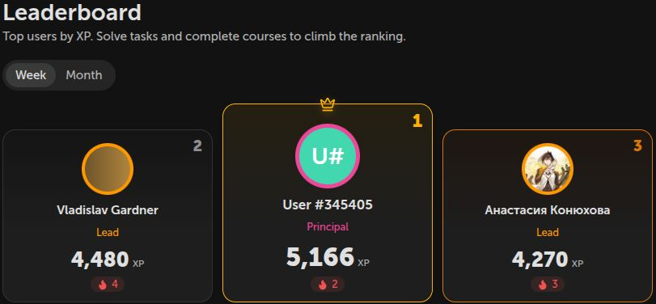

Solved 127 SQL tasks on SQL Academy, every free one in the simulator: <https://lnkd.in/eaceW85q>

Getting the green checkmark wasn't the interesting part. Digging into why a query passed, or why it almost did, was. So I wrote down everything I learned along the way and turned it into a Postgres cheat sheet, eight levels from basics and strings up to locks and indexes: <https://lnkd.in/erVauSPe>

